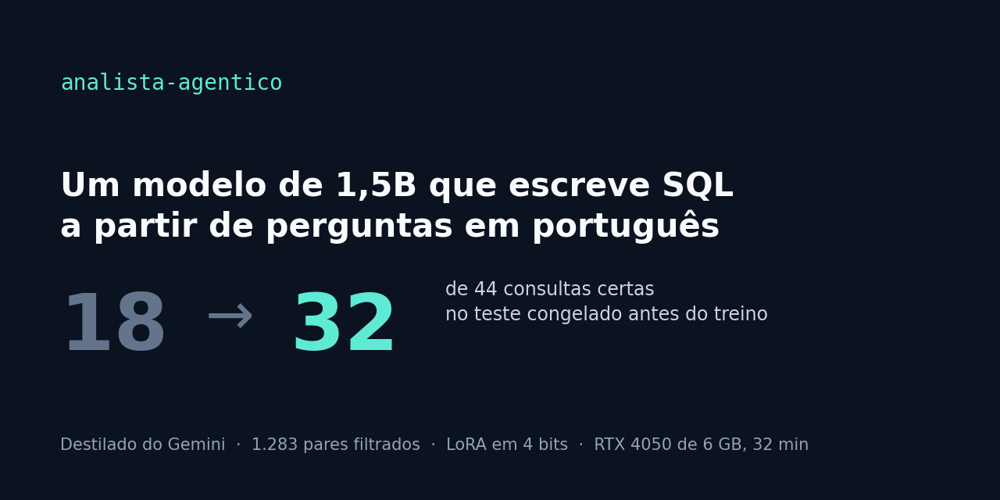
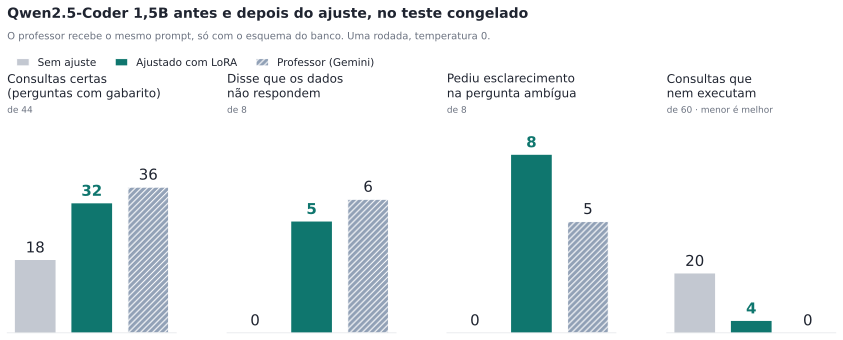
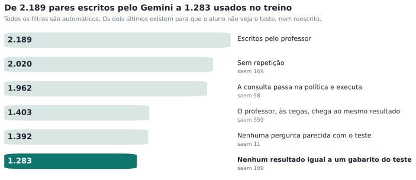

# Analista de dados agêntico



Perguntas de negócio em português sobre um dataset público brasileiro de marketplace viram
SQL somente leitura, executado num banco travado, com a consulta sempre à vista. O que
interessa aqui não é o agente, é **quanto dá para confiar nele**: acerto medido contra
gabarito, critérios escritos antes de medir e resultados publicados mesmo quando não
favorecem a ideia.

| | Resultado no conjunto de teste (congelado antes de qualquer rodada) |
|---|---|
| **Agente com Gemini 3.5 Flash Lite** | 39 de 44 consultas certas. A linha de base, sem ferramentas, fez 41: **o agente não ganhou** e gastou o dobro de tokens ([números e limites](resultados/README.md)) |
| **Destilação para um modelo de 1,5B** | De **18 para 32 de 44** com LoRA numa placa de 6 GB; o professor faz 36 ([abaixo](#destilação-um-modelo-pequeno-que-roda-num-notebook)) |
| **Segurança do SQL** | Política na árvore sintática e conexão somente leitura, sem acesso externo; uma revisão independente achou contornos, todos corrigidos e transformados em teste |

> **Em construção.** Faltam os ataques de injeção pelos dados e a demo. Um experimento
> pré-registrado testa se o agente só se paga quando a documentação do banco é incompleta;
> o primeiro resultado aponta nessa direção (com só o esquema no prompt, 39 contra 36), mas
> ainda não há conclusão.

## Destilação: um modelo pequeno que roda num notebook

O Gemini escreveu os exemplos; filtros automáticos jogaram fora o que não executava, o que
ele mesmo não confirmava às cegas e tudo o que se parecia com o teste; um
`Qwen2.5-Coder-1.5B` aprendeu com o resto em 32 minutos numa RTX 4050. O plano e os
critérios foram publicados antes do treino ([pré-registro](docs/processo/D0-destilacao-plano.md)).





O modelo passou a recusar o que os dados não respondem e a perguntar quando a pergunta é
ambígua, coisas que antes não fazia nenhuma vez. **Os limites vêm junto com o número:** um
banco só, um treino, uma semente, e em 15 das 44 perguntas o treino tem uma irmã do mesmo
molde ([resultado, auditoria de vazamento e limites](docs/processo/D2-aluno-ajustado.md)).
O adaptador está no Hugging Face: [`leozitogs/analista-olist-qwen2.5-coder-1.5b-lora`](https://huggingface.co/leozitogs/analista-olist-qwen2.5-coder-1.5b-lora)
([cartão do modelo](docs/cartao-do-modelo.md)). As figuras saem dos arquivos de resultado
com `python scripts/figuras_destilacao.py`.

O plano completo, com critérios de sucesso escritos antes de qualquer medição, está em
[PLANO.md](PLANO.md).

## O que já funciona

| Peça | Onde | O que garante |
|---|---|---|
| Carga | `src/analista/banco.py`, `visoes.sql` | CSVs viram um banco DuckDB; o agente só enxerga 7 visões em português, com tipos corretos. A carga recusa arquivo com colunas diferentes das esperadas |
| Política de SQL | `src/analista/politica.py` | Uma instrução, só `SELECT`, só sobre as visões permitidas (com CTE conferida por escopo), sem função no lugar de tabela e com funções por lista de permissão. Verificado na árvore sintática. Uma revisão independente achou dois contornos na primeira versão; estão corrigidos e viraram testes ([registro](docs/processo/B1-revisao.md)) |
| Segunda barreira | `abrir_somente_leitura` | A conexão é somente leitura, sem acesso externo e com a configuração travada, mesmo que a política falhe |
| Ferramentas | `src/analista/ferramentas.py` | Listar, descrever, amostrar e executar, com limite de linhas e de tempo |
| Comparador | `src/analista/comparar.py` | Acerto de execução sem crédito parcial; tolerância numérica relativa, com arredondamento aceito a partir de 2 casas |
| Agente | `src/analista/agente.py`, `provedor.py` | Um laço com Gemini pela API REST. Termina com uma resposta tipada: resposta, sem resposta ou pedido de esclarecimento. A consulta final passa pela política e é executada pelo agente |
| Modelo local | `src/analista/provedor.py` (`ProvedorOllama`) | O mesmo agente roda num modelo servido pelo Ollama, sem cota e sem custo por chamada. Basta usar `ollama:<nome>` como modelo |
| Destilação | `src/analista/destilacao.py`, `scripts/aluno_*.py`, `dados/destilacao/` | Pares de treino escritos por um modelo professor e filtrados por execução, por concordância e por vazamento; treino de um modelo pequeno com LoRA; medição com o mesmo comparador |
| Verificação de números | `src/analista/verificar.py` | Todo número do texto final precisa estar no resultado da consulta |
| Avaliação | `src/analista/avaliar.py` | Acerto por nível, linha de base sem ferramentas (modo `direto`) e rastro completo de cada execução |
| Perguntas de desenvolvimento | `avaliacao/perguntas/desenvolvimento.jsonl` | 20 perguntas, usadas para construir e ajustar |
| Perguntas de teste | `avaliacao/perguntas/teste.jsonl` | 60 perguntas, congeladas por hash antes da primeira rodada: 44 com SQL de gabarito em três níveis, 8 sem resposta nos dados, 8 ambíguas ([como foram feitas](docs/processo/B1-conjunto-de-teste.md)) |

## Rodar

Requer Python 3.11+ e [uv](https://docs.astral.sh/uv/).

```bash
uv sync
uv run pytest -q
```

Os testes usam dados **sintéticos** gerados na hora, no mesmo formato do dataset. Eles
provam que a base funciona; não medem nada sobre o dataset real. Com o dataset carregado,
rodam também os testes de `tests/test_dados_reais.py`.

### Com o dataset real

O projeto usa o *Brazilian E-Commerce Public Dataset by Olist*, publicado no Kaggle. Os
dados **não** estão neste repositório: confira a licença na página do dataset e baixe os
arquivos para `dados/brutos/`. Depois:

```bash
uv run analista carregar
uv run analista conferir-gabarito avaliacao/perguntas/desenvolvimento.jsonl
uv run analista sql "SELECT situacao, count(*) FROM pedidos GROUP BY 1"
```

### Com o agente

A chave e o modelo vêm do ambiente; nada disso fica no repositório.

```bash
export GEMINI_API_KEY=...        # sua chave
uv run analista modelos           # lista os modelos da sua conta
export ANALISTA_MODELO=...        # um nome da lista (usado até aqui: gemini-3.5-flash-lite)
uv run analista perguntar "Quantos pedidos foram cancelados?"
uv run analista avaliar avaliacao/perguntas/desenvolvimento.jsonl --saida resultados/dev-agente.jsonl
uv run analista avaliar avaliacao/perguntas/desenvolvimento.jsonl --modo direto --saida resultados/dev-direto.jsonl
```

Com um modelo local, no lugar das duas variáveis do Gemini:

```bash
uv run analista perguntar "Quantos pedidos foram cancelados?" --modelo ollama:qwen3:4b-instruct
uv run analista avaliar avaliacao/perguntas/desenvolvimento.jsonl --modelo ollama:qwen3:4b-instruct
```

## O que falta

- Revisão humana do SQL dos gabaritos (o revisor viu as perguntas e as respostas, não o SQL).
- Refazer o treino da destilação com outra semente para medir a variação.
- Terminar o experimento do contexto: nível `nenhum` e as repetições que medem o ruído entre rodadas (interrompido pela cota gratuita).
- Os ataques de injeção pelos dados, a demo e o relatório (B2).

## Limitações conhecidas

- **A política de SQL é uma lista de regras escrita à mão sobre um analisador sintático.** Já falhou uma vez. A segunda barreira (conexão somente leitura, sem acesso externo, com teto de memória) existe porque a primeira pode falhar de novo.
- **Consulta cara:** o tempo limite interrompe a consulta, mas até lá ela ocupa processador e memória. Não exponha isto a usuários não confiáveis sem isolamento de processo.
- **Comparador:** se o agente arredonda o resultado, uma consulta errada que só difere depois da casa arredondada passa como acerto.
- **Verificação de números:** aceita a contagem de linhas do resultado como origem de um número; não reconhece porcentagem escrita a partir de fração (8,1% para 0,081) nem número por extenso; não é aplicada a respostas do tipo "sem resposta" e "esclarecimento".
- **Medição:** uma rodada por configuração; 44 perguntas com SQL dão intervalos largos.

## Dados e licenças

- **Código:** Apache-2.0 ([LICENSE](LICENSE)).
- **Dados:** [Brazilian E-Commerce Public Dataset by Olist](https://www.kaggle.com/datasets/olistbr/brazilian-ecommerce), publicado no Kaggle sob [CC BY-NC-SA 4.0](https://creativecommons.org/licenses/by-nc-sa/4.0/). O dataset **não** está neste repositório.
- **Rastros:** cada rastro guarda no máximo 50 linhas do resultado de uma consulta; o julgamento usa o resultado inteiro.
- **Derivados dos dados:** os arquivos em `resultados/` (resultados de consultas) e as estatísticas citadas em `docs/dicionario-de-dados.md` derivam desse dataset e ficam sob a mesma licença CC BY-NC-SA 4.0: atribuição à Olist, uso não comercial, mesma licença para obras derivadas.

## Como este repositório é construído

Com agentes de código, e isso fica à vista: as instruções deles estão em
[AGENTS.md](AGENTS.md), e cada etapa deixa um registro em `docs/processo/` dizendo o que
foi delegado, o que foi revisado e o que os testes pegaram.
